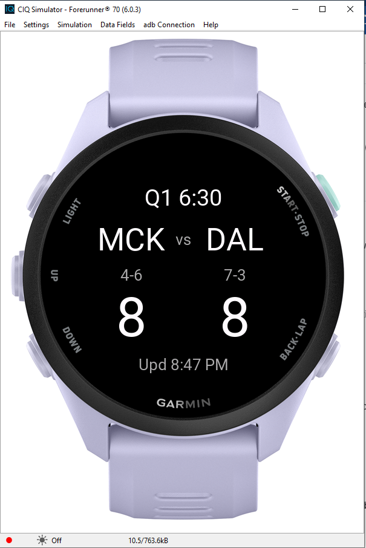

<a id="readme-top"></a>

<!-- PROJECT SHIELDS -->
[![Issues][issues-shield]][issues-url]
[![License][license-shield]][license-url]
[![LinkedIn][linkedin-shield]][linkedin-url]

<!-- PROJECT HEADER -->
<br />
<div align="center">
  <h3 align="center">Mavs Game Alerts</h3>

  <p align="center">
    A native Garmin Connect IQ watch app that tracks the Dallas Mavericks live and vibrates when a new quarter begins.
    <br />
    <a href="#usage"><strong>Explore the docs »</strong></a>
    <br />
    <br />
    <a href="#usage">View Demo</a>
    ·
    <a href="https://github.com/Nhessity/Mavs-Tracker/issues/new?labels=bug">Report Bug</a>
    ·
    <a href="https://github.com/Nhessity/Mavs-Tracker/issues/new?labels=enhancement">Request Feature</a>
  </p>
</div>

<!-- TABLE OF CONTENTS -->
<details>
  <summary>Table of Contents</summary>
  <ol>
    <li>
      <a href="#about-the-project">About The Project</a>
      <ul>
        <li><a href="#built-with">Built With</a></li>
        <li><a href="#architecture">Architecture</a></li>
      </ul>
    </li>
    <li>
      <a href="#getting-started">Getting Started</a>
      <ul>
        <li><a href="#prerequisites">Prerequisites</a></li>
        <li><a href="#installation">Installation</a></li>
      </ul>
    </li>
    <li>
      <a href="#usage">Usage</a>
      <ul>
        <li><a href="#watch-controls-and-display">Watch Controls and Display</a></li>
        <li><a href="#testing-modes">Testing Modes</a></li>
        <li><a href="#worker-response-format">Worker Response Format</a></li>
      </ul>
    </li>
    <li><a href="#limitations">Limitations</a></li>
    <li><a href="#roadmap">Roadmap</a></li>
    <li><a href="#contributing">Contributing</a></li>
    <li><a href="#license">License</a></li>
    <li><a href="#contact">Contact</a></li>
    <li><a href="#acknowledgments">Acknowledgments</a></li>
  </ol>
</details>

<!-- ABOUT THE PROJECT -->
## About The Project

<div align="center">
  <a href="images/mavstrackerdemo.png">
    
  </a>
  <br />
  <sub>Forerunner 70 simulator running the built-in mock game</sub>
</div>


Mavs Game Alerts is a small portfolio project: a native Garmin Connect IQ app (Monkey C) that watches the Dallas Mavericks game in progress and gives your wrist a buzz whenever a new quarter starts. I started this project because I really wanted to be able to check the status of a live Ddallas Mavericks game and be alerted to return to watching the game during intermissions for when I have to step away from the screen. The project use case is pretty specific to my favorite basketball team and my watch, but I would love to expand it further in the future.

What it does:

* Finds today's Mavericks game and shows the matchup with the **away team on the left and the home team on the right**
* Shows the quarter and time remaining, **Halftime**, or **Final**
* Before tip-off, shows the scheduled start time in your **local time zone**
* Shows each team's abbreviation, win/loss record, and current score
* **Vibrates when a new quarter begins** (including overtime) and never repeats the alert for the same quarter
* Handles network failures and missing fields without crashing

What it demonstrates:

* Calling a REST API and parsing JSON on a memory-constrained device
* State management and event detection (comparing the current period to the previous one)
* Hardware features (vibration) and native Connect IQ UI drawing
* Working around a hardware limitation with a minimal proxy (see [Architecture](#architecture))

> **Disclaimer:** This is an unofficial hobby project. It is not affiliated with or endorsed by the NBA, ESPN, the Dallas Mavericks, or Garmin. It uses ESPN's unofficial, undocumented scoreboard endpoint, which may change or stop working at any time.

<p align="right">(<a href="#readme-top">back to top</a>)</p>

### Built With

[![Garmin Connect IQ][garmin-shield]][garmin-url]
[![Cloudflare Workers][cloudflare-shield]][cloudflare-url]
[![JavaScript][js-shield]][js-url]

* Monkey C and the Garmin Connect IQ SDK (target device: Garmin Forerunner 70)
* Visual Studio Code with the Monkey C extension
* A single Cloudflare Worker (JavaScript) as a tiny proxy
* ESPN's unofficial NBA scoreboard endpoint as the data source

<p align="right">(<a href="#readme-top">back to top</a>)</p>

### Architecture

```
┌──────────────┐   HTTPS (JSON, ~300 bytes)   ┌───────────────────┐   HTTPS (JSON, large)   ┌──────────────┐
│ Garmin watch │ ───────────────────────────► │ Cloudflare Worker │ ──────────────────────► │ ESPN         │
│ (Monkey C)   │ ◄─────────────────────────── │ (filters to DAL)  │ ◄────────────────────── │ scoreboard   │
└──────────────┘                              └───────────────────┘                         └──────────────┘
```

**Why a proxy?** The original plan was a watch-only app talking directly to ESPN. In practice, ESPN's NBA scoreboard response is far too large: Connect IQ loads the whole response into watch memory and has no way to filter it, so the request fails with a "response too large" error (-402). The Worker fetches the scoreboard, extracts only the Mavericks game, and returns a small flat JSON object the watch can parse comfortably. It also caches the ESPN response for 15 seconds at Cloudflare's edge, which keeps load on ESPN low.

<p align="right">(<a href="#readme-top">back to top</a>)</p>

<!-- GETTING STARTED -->
## Getting Started

### Prerequisites

* [Visual Studio Code](https://code.visualstudio.com/) with the **Monkey C** extension
* The [Garmin Connect IQ SDK](https://developer.garmin.com/connect-iq/sdk/) (install through the SDK Manager, including the Forerunner 70 device files)
* A Connect IQ developer key (generated by the Monkey C extension; **never commit it**)
* [Node.js](https://nodejs.org/) and a free [Cloudflare account](https://dash.cloudflare.com/sign-up) to deploy your own Worker

### Installation

Each user runs their own Worker; there is no shared hosted instance.

1. Clone the repo
   ```sh
   git clone https://github.com/Nhessity/Mavs-Tracker.git
   ```
2. Deploy your Worker
   ```sh
   cd worker
   npx wrangler login
   npx wrangler dev     # optional: test locally
   npx wrangler deploy  # prints your https://<name>.<subdomain>.workers.dev URL
   ```
   Open the printed URL in a browser. You should see `{"found":false}` on a day without a Mavericks game, or the game JSON on a game day.
3. *(Recommended)* Protect your Worker with a shared secret so only your watch can use it:
   ```sh
   npx wrangler secret put API_KEY   # paste a long random string when prompted
   ```
   Once `API_KEY` is set, the Worker rejects requests that don't send a matching `x-api-key` header (HTTP 401). For local testing with `wrangler dev`, put `API_KEY=...` in a `.dev.vars` file (git-ignored).
4. Create your local config. Copy `source/Config.mc.example` to `source/Config.mc` and fill it in:
   ```monkey
   const WORKER_BASE = "https://<name>.<subdomain>.workers.dev/";
   const WORKER_KEY = "<the same string you used for API_KEY, or empty>";
   ```
   `source/Config.mc` is git-ignored so your Worker URL and key stay out of the repo.
5. Confirm `manifest.xml` has:
   * the Forerunner 70 listed as a product
   * the `Communications` permission:
     ```xml
     <iq:uses-permission id="Communications"/>
     ```
6. Build and run in the simulator: press `F5` (or run **Monkey C: Run Without Debugging**) and choose the Forerunner 70.
7. *(Optional)* Run on a physical watch: build for the device (**Monkey C: Build for Device**), connect the watch over USB, and copy the generated `.prg` file into the watch's `GARMIN/Apps` folder.

> **Note on the key:** the key is compiled into the app you install on your own watch, so treat it as a lightweight deterrent against strangers using your Worker, not strong security. Don't share your built `.prg` file.

<p align="right">(<a href="#readme-top">back to top</a>)</p>

<!-- USAGE -->
## Usage

### Watch Controls and Display

Launch the app and leave it open during the game. It polls roughly **once every 60 seconds** and only while there is a game to follow: polling stops when there is no game today or the game is final.

Screen layout, top to bottom:

1. **Status**: quarter and time remaining (`Q2 7:42`), `Halftime`, `Final`, or the local start time before tip-off (`Starts 7:30 PM`)
2. **Team abbreviations**: away team on the left, home team on the right
3. **Records**: each team's win/loss record under its abbreviation
4. **Scores**: each team's score under its record (hidden before tip-off)
5. A small `Upd` timestamp at the bottom shows the time of the last successful update, which is handy for confirming that polling keeps running while the screen is asleep

| Input      | Action                                                   |
|------------|----------------------------------------------------------|
| UP / DOWN  | Refresh now (also restarts polling after it has stopped) |

A vibration fires whenever the observed period increases. Launching the app mid-game sets a silent baseline, so you will not get a false alert on startup.

### Testing Modes

Two constants at the top of `source/Mavs-TrackerView.mc` make testing easier when the Mavericks are not playing:

| Constant      | Default | Purpose                                                                                       |
|---------------|---------|-----------------------------------------------------------------------------------------------|
| `USE_MOCK`    | `false` | `true` runs a fake game with no network: pre-game, Q1-Q4, halftime, then final, advancing every 5 seconds |
| `TEAM_ABBR`   | `"DAL"` | Set to another ESPN team abbreviation (for example `"GS"`) to follow a different live game     |

Set both back to their defaults before committing or demoing.

### Worker Response Format

The Worker returns a small flat JSON object. When the Mavericks have a game today:

```json
{
  "found": true,
  "gameId": "401909999",
  "state": "in",
  "statusName": "STATUS_IN_PROGRESS",
  "period": 2,
  "clock": "7:42",
  "startTime": 1793000000,
  "detail": "Q2 7:42",
  "mavsHomeAway": "home",
  "opponent": "Pistons",
  "opponentAbbr": "DET",
  "home": { "abbr": "DAL", "name": "Mavericks", "record": "7-3", "score": 54 },
  "away": { "abbr": "DET", "name": "Pistons",   "record": "5-5", "score": 49 },
  "mavsScore": 54,
  "opponentScore": 49
}
```

* `state` is `pre`, `in`, or `post`
* `startTime` is the scheduled tip-off in UTC epoch seconds; the watch converts it to local time
* With no game today the response is `{"found": false}`; if ESPN fails the Worker returns HTTP 502 with `{"error": "..."}`
* The optional `?team=GS` query parameter selects a different team (used by `TEAM_ABBR`)

<p align="right">(<a href="#readme-top">back to top</a>)</p>

<!-- LIMITATIONS -->
## Limitations

* **Foreground only.** Connect IQ background services have a minimum temporal interval of about five minutes and cannot call `Attention.vibrate()` directly, so this prototype keeps the app open and polls in the foreground. Nothing is delivered while the app is closed.
* **Alert latency.** Polling every 60 seconds plus ESPN's own update delay means a quarter alert can arrive a minute or more after the quarter actually starts.
* **Unofficial data source.** ESPN's endpoint is undocumented and may change, rate-limit, or disappear without notice.
* **Needs a phone connection.** Watch web requests go through the paired phone, so the watch needs a Bluetooth connection (and the phone needs internet access).
* **Battery.** A connected app polling once a minute uses more battery than an idle watch face. Real-world battery impact has not been measured.
* **End-of-period breaks.** Only halftime has its own status. Other breaks (end of Q1, Q3, Q4) may briefly show a `0:00` clock.
* **Display tuning.** Font sizes and positions were chosen without testing on every screen shape and size; very long scores or abbreviations may look tight.

<p align="right">(<a href="#readme-top">back to top</a>)</p>

<!-- ROADMAP -->
## Roadmap

- [x] Basic watch interface and Connect IQ project setup
- [x] Cloudflare Worker proxy that filters ESPN to the Mavericks game
- [x] Opponent, home/away order, records, scores, quarter, and clock
- [x] Local-time start display before tip-off
- [x] Quarter-change vibration with duplicate protection
- [x] Halftime status
- [x] Mock-game and alternate-team testing modes
- [ ] Dedicated statuses for end of Q1 / Q3 / Q4
- [ ] Measure battery impact on a physical watch
- [ ] Explore and add more screens to show current team statistics such as: team FG, FT, REB, AST, and TO
- [ ] Allow users to select which basketball teams they'd like to follow
- [ ] Add a screen that shows future games when there are no games being played that day
- [ ] Make the UI look prettier
- [ ] Explore other API sources in the future

See the [open issues](https://github.com/Nhessity/Mavs-Tracker/issues) for a full list of proposed features (and known issues).

<p align="right">(<a href="#readme-top">back to top</a>)</p>

<!-- CONTRIBUTING -->
## Contributing

Contributions are what make the open source community such an amazing place to learn, inspire, and create. Any contributions you make are **greatly appreciated**.

If you have a suggestion that would make this better, please fork the repo and create a pull request. You can also simply open an issue with the tag "enhancement".

1. Fork the Project
2. Create your Feature Branch (`git checkout -b feature/AmazingFeature`)
3. Commit your Changes (`git commit -m 'Add some AmazingFeature'`)
4. Push to the Branch (`git push origin feature/AmazingFeature`)
5. Open a Pull Request

Please do not commit build output (`bin/`, `*.prg`) or signing keys (`*.der`).

<p align="right">(<a href="#readme-top">back to top</a>)</p>

<!-- CONTACT -->
## Contact

Jimmy Nhes - [LinkedIn](https://www.linkedin.com/in/jimmy-nhes/) - nhesjimmy1@gmail.com

Project Link: [https://github.com/Nhessity/Mavs-Tracker](https://github.com/Nhessity/Mavs-Tracker)

<p align="right">(<a href="#readme-top">back to top</a>)</p>

<!-- ACKNOWLEDGMENTS -->
## Acknowledgments

* [Garmin Connect IQ developer documentation](https://developer.garmin.com/connect-iq/overview/)
* [Cloudflare Workers documentation](https://developers.cloudflare.com/workers/)
* [Best-README-Template](https://github.com/othneildrew/Best-README-Template)
* [Img Shields](https://shields.io)

<p align="right">(<a href="#readme-top">back to top</a>)</p>

<!-- MARKDOWN LINKS & IMAGES -->
[issues-shield]: https://img.shields.io/github/issues/Nhessity/Mavs-Tracker.svg?style=for-the-badge
[issues-url]: https://github.com/Nhessity/Mavs-Tracker/issues
[license-shield]: https://img.shields.io/github/license/Nhessity/Mavs-Tracker.svg?style=for-the-badge
[license-url]: https://github.com/Nhessity/Mavs-Tracker/blob/main/LICENSE
[linkedin-shield]: https://img.shields.io/badge/-LinkedIn-black.svg?style=for-the-badge&logo=linkedin&colorB=555
[linkedin-url]: https://www.linkedin.com/in/jimmy-nhes/
[product-screenshot]: images/screenshot.png
[garmin-shield]: https://img.shields.io/badge/Garmin_Connect_IQ-007CC3?style=for-the-badge&logo=garmin&logoColor=white
[garmin-url]: https://developer.garmin.com/connect-iq/overview/
[cloudflare-shield]: https://img.shields.io/badge/Cloudflare_Workers-F38020?style=for-the-badge&logo=cloudflare&logoColor=white
[cloudflare-url]: https://workers.cloudflare.com/
[js-shield]: https://img.shields.io/badge/JavaScript-F7DF1E?style=for-the-badge&logo=javascript&logoColor=black
[js-url]: https://developer.mozilla.org/en-US/docs/Web/JavaScript
